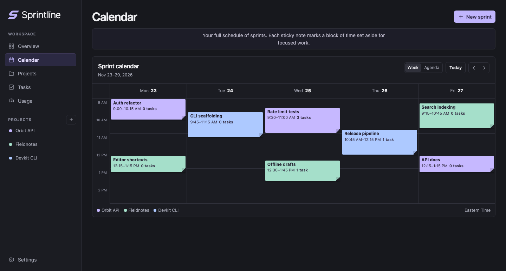

# Sprintline

**Plan your next coding sprint around the time and tools you have.**

Sprintline is a personal workspace for scheduling focused coding sessions, connecting them to project tasks, and tracking when your AI coding tools reset. It runs in your browser and works offline after the initial online visit.

[**Open Sprintline**](https://boredpolymath.github.io/Sprintline/)

## Make time for the work

- **Block out your week.** Schedule coding sprints on a color-coded calendar, spot overlaps, and switch to an agenda when you want a day-by-day list.
- **Know what belongs in each sprint.** Group tasks by project, attach them to a session, and mark them done as you work. The calendar shows how many tasks each sprint has.
- **Get into focus mode.** Start, pause, or resume a sprint timer. Check the Overview to see your current sprint and what’s coming up.
- **Plan around tool limits.** Record remaining allowance and reset times for Codex or any other coding tool you use. Usage readings are entered manually.
- **Take your workspace offline.** Open Sprintline online once, then schedule sessions and update tasks without a connection. Add it to your Home Screen where your browser supports installation.

## Your workspace stays in your browser

Sprintline uses browser storage for projects, tasks, schedules, and usage readings. Use **Settings → Export JSON** to keep a backup. **Import JSON** restores that backup or moves it to another browser or device.

## Contributing

See the [contributing guide](CONTRIBUTING.md) to run Sprintline locally, report bugs, or propose changes. See the [security policy](SECURITY.md) to report a vulnerability privately.

## License

Sprintline is released under the [MIT License](LICENSE).
